<p align="center">
  <picture>
    <source media="(prefers-color-scheme: dark)" srcset="docs/logo-dark.png">
    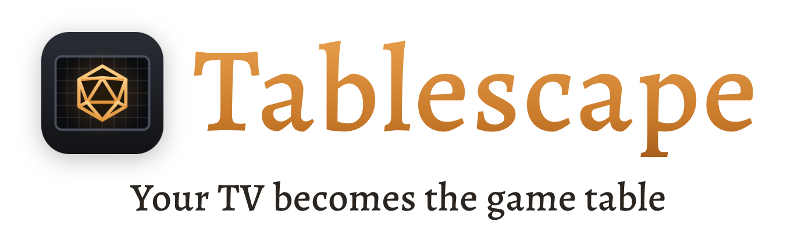
  </picture>
</p>

<p align="center">
  Animated battle maps, fog of war, spell effects, lights and weather for D&amp;D,<br>
  on a TV lying flat, a projector, or a TV on its stand. Free and open source, for Windows.
</p>

<p align="center">
  <a href="https://github.com/glinnbo/tablescape/releases/latest"><b>Download for Windows</b></a>
  &nbsp;·&nbsp;
  <a href="https://discord.gg/T99DRNKaSM">Discord</a>
</p>

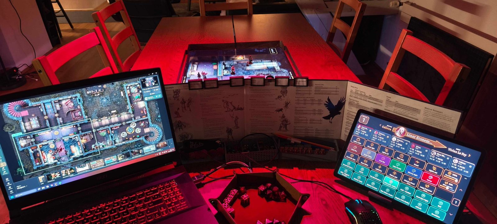

## Made for the table

Most map tools were built for playing online and can also be put on a TV. Tablescape is built the other way round: for one room, real miniatures, and a screen everyone sits around.

### The basics: your first evening

You need a laptop and a TV or projector. Nothing else has to be set up.

- **One key sends the map to the TV.** Pictures and animated maps both work.
- **Fog you paint away** as the party explores, and paint back when the door shuts.
- **One inch is one inch.** Hold a bank card against the TV once, and every grid fits your miniatures from then on.
- **NPC tokens and a party marker** for everything that has no miniature.
- **Campaigns, chapters and maps** in plain folders, with ambience per chapter.
- **Title, break and blackout screens**, a check before you start, undo and redo.

### What sets it apart

- **NPCs step onto the table to talk.** Start a conversation and the NPC's portrait rises on the TV, facing both sides of the table. Monsters can be revealed in a spotlight.
- **A world the party travels.** The Cartographer shows your world map like a globe, with mist at its edges, weather, named places and routes that fill in as the party walks them. Dive through the clouds into a regional map and back out.
- **Handouts that burn onto the table.** Letters, maps and pictures appear out of embers, up to ten at once, placed, sized and turned as you like. They can go to the players' phones too.
- **Screen effects.** One click and the whole table reacts: an earthquake, a dragon's roar, frost creeping in, gold sparks for a natural 20.
- **The room plays along.** Room lights (IKEA, Govee) follow the colours on the TV and flash with lightning and spells. Spotify moods and a soundboard are one click away.
- **The table has a style.** 23 table styles from Deep dungeon to Jungle, each with its own map change, turn order and round banner.
- **Phones belong to the table.** Players move their own tokens from their phones. Your phone or tablet is the remote, with button decks you arrange yourself.

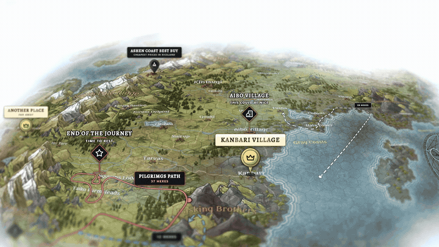

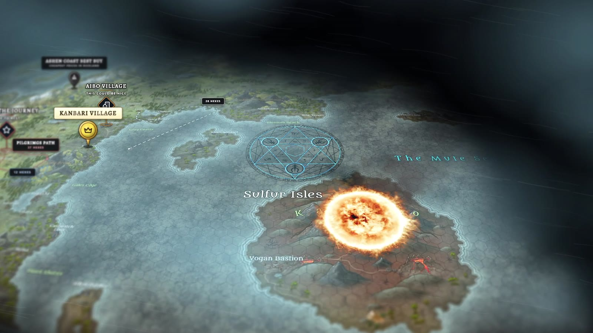

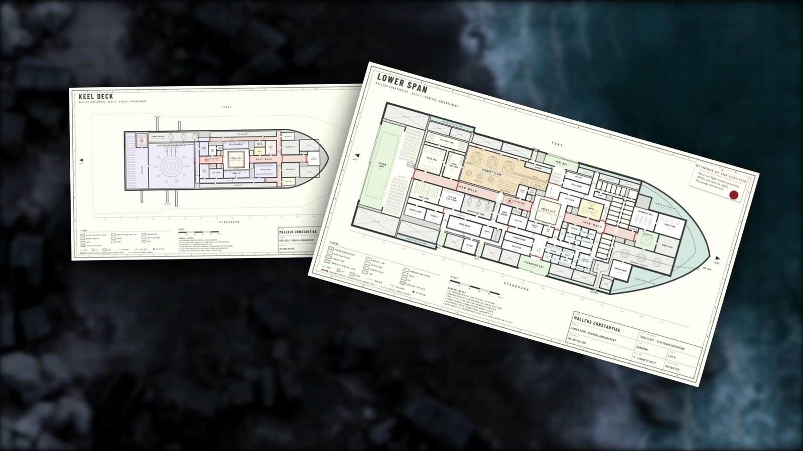

### When you want more

Everything else waits in the Toolbox until you open it:

| On the map | Around the table |
| --- | --- |
| 49 D&amp;D spell areas | Initiative with a round banner and your own columns |
| Effects: water, lava, mist, webs, burning ground | Character cards |
| Light and weather | Dice, the wheel of luck and death saves |
| Walls, doors and line of sight | Snapshots of a map, back with one key |

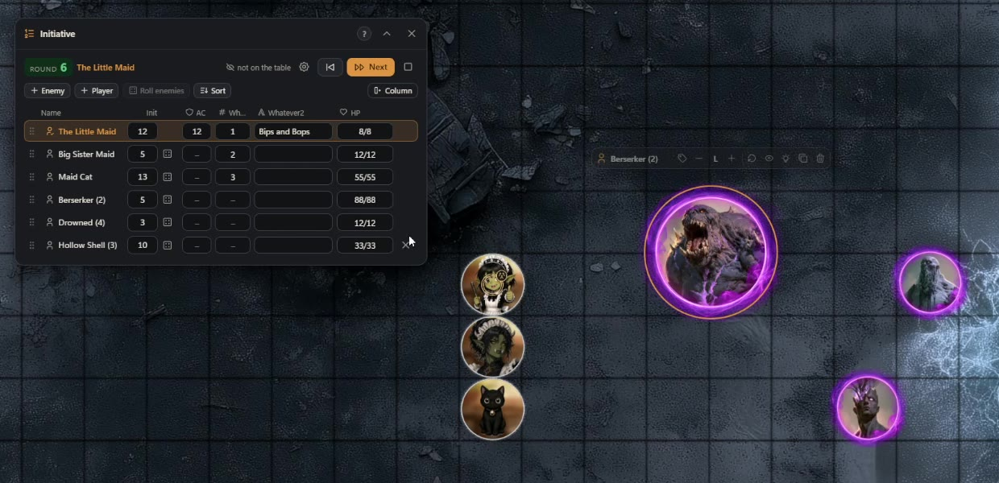

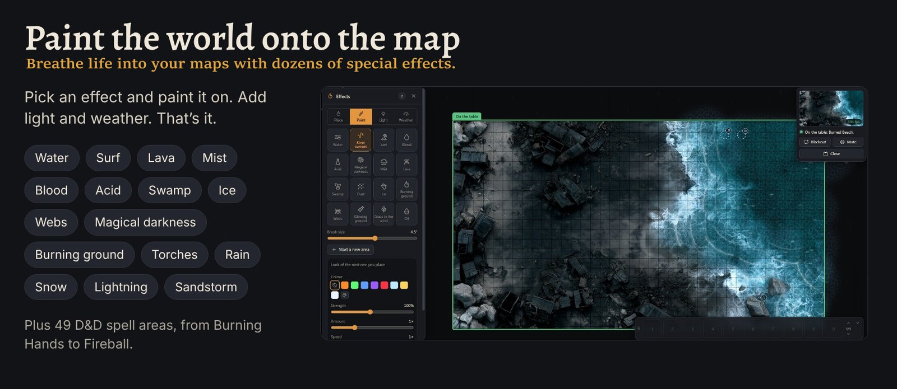

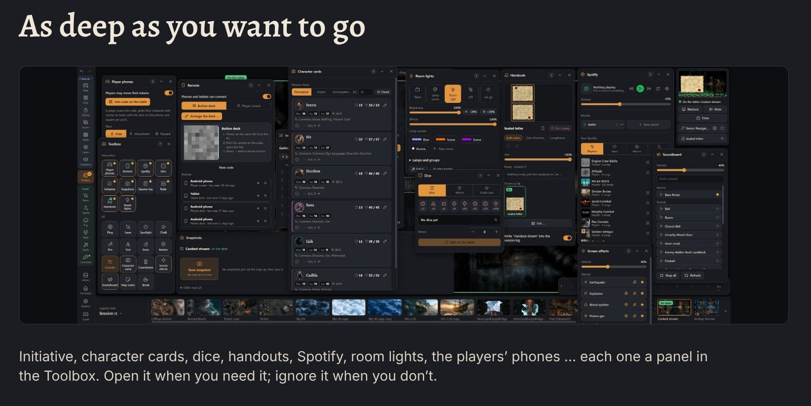

## Get started

1. Download **Tablescape-Setup-….exe** from the [latest release](https://github.com/glinnbo/tablescape/releases/latest) (under **Assets**).
2. Run it. The installer isn't signed yet, so Windows may say *"Windows protected your PC"*: click **More info → Run anyway**.
3. Tablescape opens on its home screen with a demo campaign. Under **Options → TV**, pick the TV and match the grid to your miniatures with a bank card. Then **Prepare the maps**, pick a map and press **T** to send it to the table.

New versions come by themselves: Tablescape asks before it installs one. It needs Windows 10 or 11 and a second screen; phones and tablets join over your own Wi-Fi.

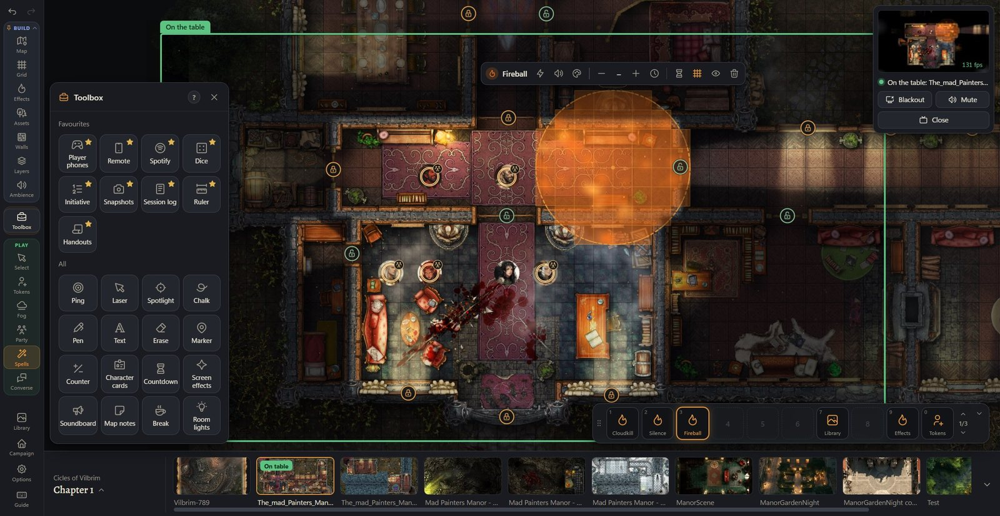

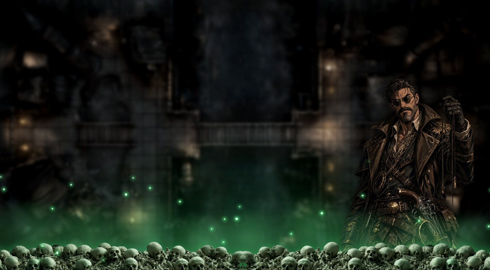

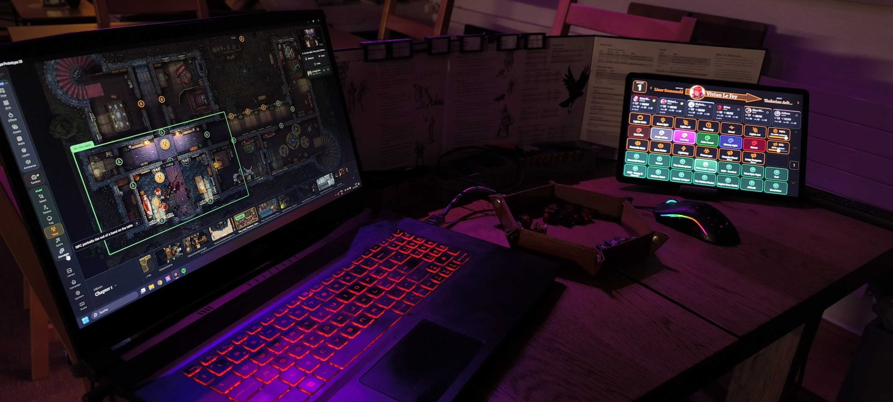

## Your files stay yours

Campaigns, maps, tokens and sounds are plain folders on your PC. No account, no cloud, no ads, no tracking.

## Help, bugs and ideas

Join the [Tablescape Discord](https://discord.gg/T99DRNKaSM): **#help** for questions, **#bug-reports** for problems (Guide → Report a problem makes the file to attach), **#ideas** for wishes. Inside the app, press **?** for the Guide.

## Support

Tablescape is free and made by a forever DM. If it makes your table a little more magical, [toss a coin on Ko-fi](https://ko-fi.com/tablescape).

## Open source

Tablescape is open source under the [GNU General Public License, version 3](LICENSE.txt): use it at any table, share it, change it. A changed version you pass on stays open source under the same license. The code of every version is right here, next to its download.

**Your own version:** the license covers the code, not the name. Please give your version its own name and logo, so nobody mistakes it for the original (saying it's based on Tablescape is welcome). Details in [NOTICE.txt](NOTICE.txt).

**Ideas and bug reports:** on [Discord](https://discord.gg/T99DRNKaSM). For now Tablescape takes ideas, not code from others.

### Build it yourself

You need Windows 10 or 11, [Node.js](https://nodejs.org) 22 and git.

```
npm ci
npm start          # run it
npm test           # the self-test, about 4 minutes
npm run dist:win   # the installer, in release/
```

## Credits

Icons: Tabler Icons (MIT). Display font: Alegreya (SIL Open Font License). Table-style pictures: made with Midjourney and Grok. Built with Electron.

This work includes material taken from the System Reference Document 5.1 ("SRD 5.1") by Wizards of the Coast LLC and available at https://dnd.wizards.com/resources/systems-reference-document. The SRD 5.1 is licensed under the Creative Commons Attribution 4.0 International License available at https://creativecommons.org/licenses/by/4.0/legalcode.

Tablescape is an unofficial fan product, not made or endorsed by Wizards of the Coast. Dungeons &amp; Dragons and D&amp;D are trademarks of Wizards of the Coast.
