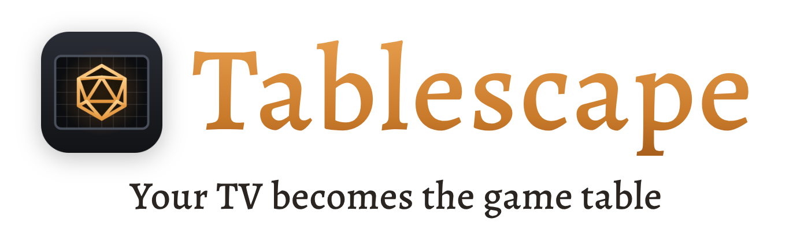
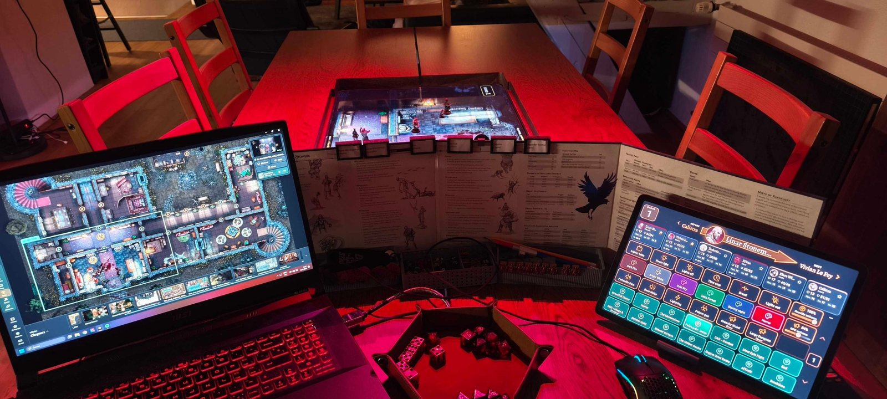
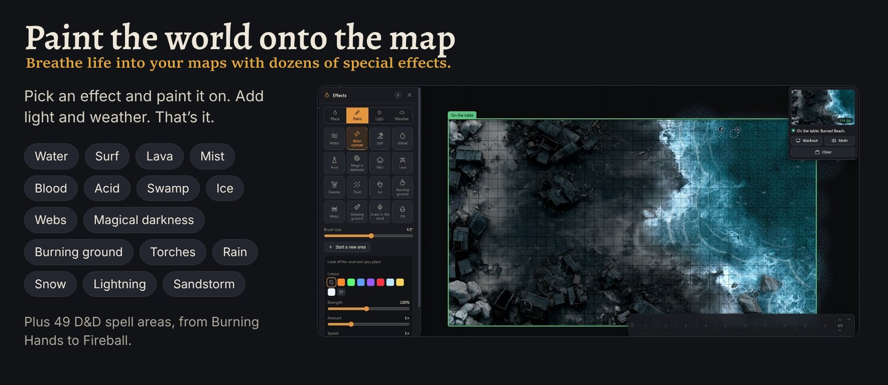
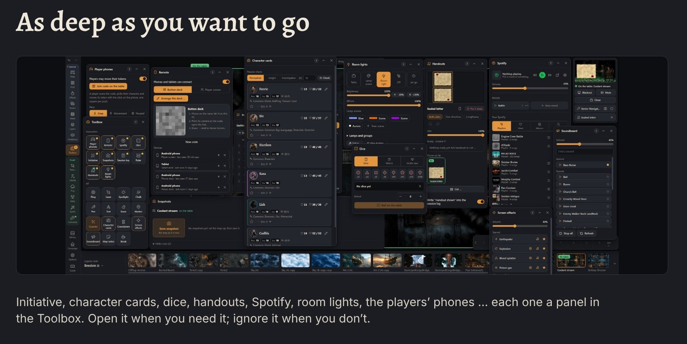
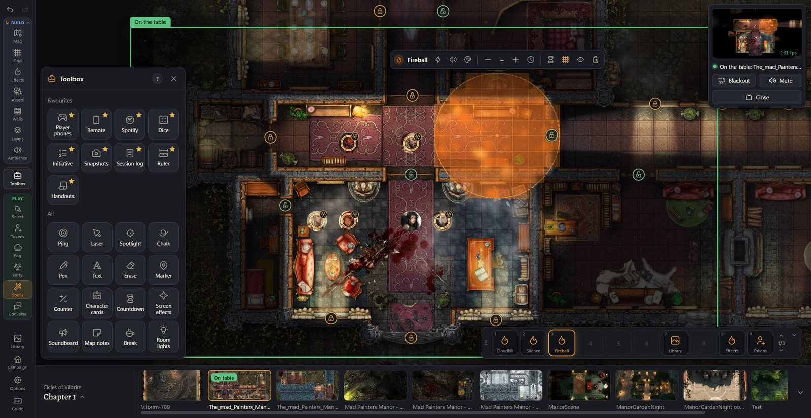
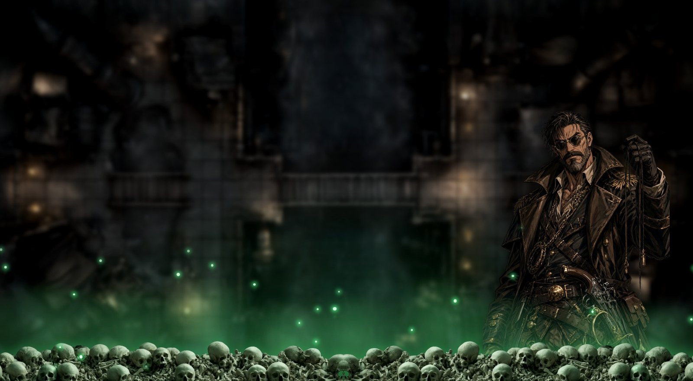
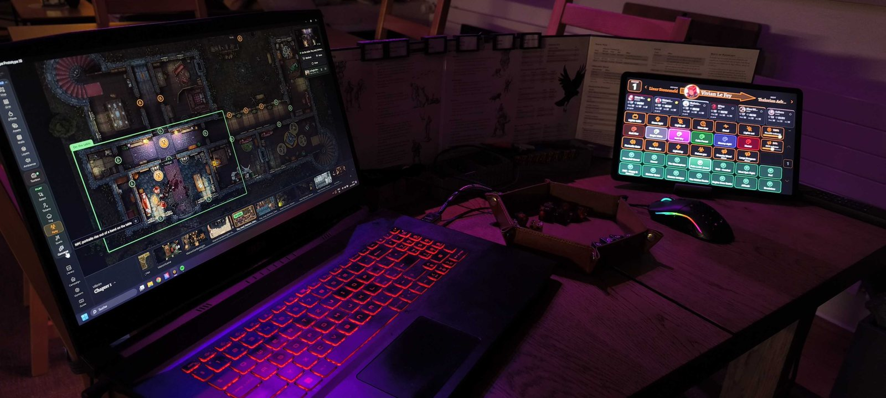

<p align="center">
  <picture>
    <source media="(prefers-color-scheme: dark)" srcset="docs/logo-dark.png">
    
  </picture>
</p>

<p align="center">
  Animated battle maps, fog of war, spell effects, lights and weather for D&amp;D,<br>
  on a TV lying flat, a projector, or a TV on its stand. Free and open source, for Windows.
</p>

<p align="center">
  <a href="https://github.com/glinnbo/tablescape/releases/latest"><b>Download for Windows</b></a>
  &nbsp;·&nbsp;
  <a href="https://discord.gg/T99DRNKaSM">Discord</a>
  &nbsp;·&nbsp;
  <a href="https://ko-fi.com/tablescape">Toss a coin</a>
</p>



## Simple by default, as deep as you want

You need a laptop and a TV or projector. Send a map to the table with one key, uncover it as the party explores, and you're playing. Everything else waits in the Toolbox until you want it.

| The basics | When you want more |
| --- | --- |
| Campaigns, chapters and maps | 49 D&amp;D spell areas, effects, light and weather |
| A map on the TV with one key | Walls, doors and line of sight |
| Reveal and cover the fog | NPCs who step onto the table to talk, monsters shown in a spotlight |
| NPC tokens and a party marker | 23 table styles, from Deep dungeon to Jungle |
| A grid at real inch scale | Initiative with a round banner, character cards |
| Ambience per chapter | Handouts, also on the players' phones |
| Title, break and blackout screens | Players move their tokens from their phones |
| A check before you start | A phone or tablet as your remote |
| Undo and redo | Spotify moods, a soundboard, room lights (IKEA, Govee) |





## Get started

1. Download **Tablescape-Setup-….exe** from the [latest release](https://github.com/glinnbo/tablescape/releases/latest) (under **Assets**).
2. Run it. The installer isn't signed yet, so Windows may say *"Windows protected your PC"*: click **More info → Run anyway**.
3. Tablescape opens with a demo campaign. The **First steps** on the start screen walk you through it: pick the TV, match the grid to your miniatures with a bank card, send a map to the table.

New versions come by themselves: Tablescape asks before it installs one. It needs Windows 10 or 11 and a second screen; phones and tablets join over your own Wi-Fi.







## Your files stay yours

Campaigns, maps, tokens and sounds are plain folders on your PC. No account, no cloud, no ads, no tracking.

## Help, bugs and ideas

Join the [Tablescape Discord](https://discord.gg/T99DRNKaSM): **#help** for questions, **#bug-reports** for problems (Guide → Report a problem makes the file to attach), **#ideas** for wishes. Inside the app, press **?** for the Guide.

## Support

Tablescape is free and made by a forever DM. If it makes your table a little more magical, [toss a coin on Ko-fi](https://ko-fi.com/tablescape).

## Open source

Tablescape is open source under the [GNU General Public License, version 3](LICENSE.txt): use it at any table, share it, change it. A changed version you pass on stays open source under the same license. The code of every version is right here, next to its download.

**Your own version:** the license covers the code, not the name. Please give your version its own name and logo, so nobody mistakes it for the original (saying it's based on Tablescape is welcome). Details in [NOTICE.txt](NOTICE.txt).

**Ideas and bug reports:** on [Discord](https://discord.gg/T99DRNKaSM). For now Tablescape takes ideas, not code from others.

### Build it yourself

You need Windows 10 or 11, [Node.js](https://nodejs.org) 22 and git.

```
npm ci
npm start          # run it
npm test           # the self-test, about 4 minutes
npm run dist:win   # the installer, in release/
```

## Credits

Icons: Tabler Icons (MIT). Display font: Alegreya (SIL Open Font License). Table-style pictures: made with Midjourney and Grok. Built with Electron.

This work includes material taken from the System Reference Document 5.1 ("SRD 5.1") by Wizards of the Coast LLC and available at https://dnd.wizards.com/resources/systems-reference-document. The SRD 5.1 is licensed under the Creative Commons Attribution 4.0 International License available at https://creativecommons.org/licenses/by/4.0/legalcode.

Tablescape is an unofficial fan product, not made or endorsed by Wizards of the Coast. Dungeons &amp; Dragons and D&amp;D are trademarks of Wizards of the Coast.
